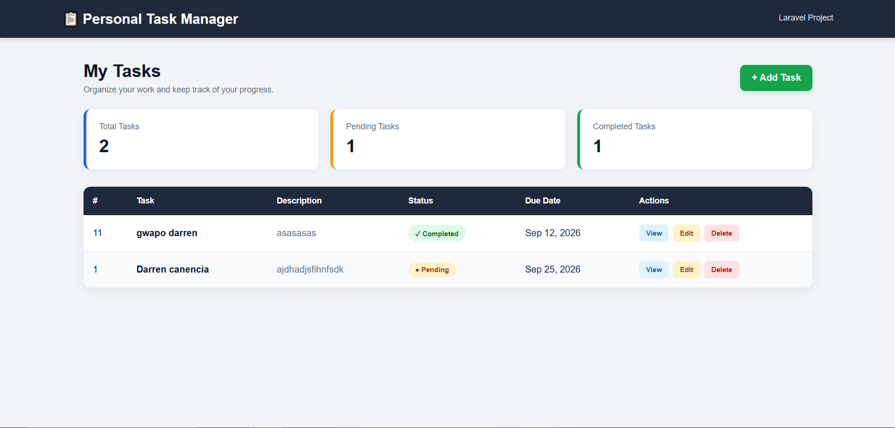
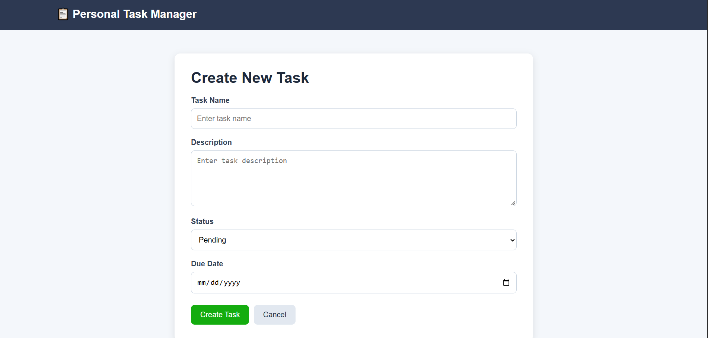
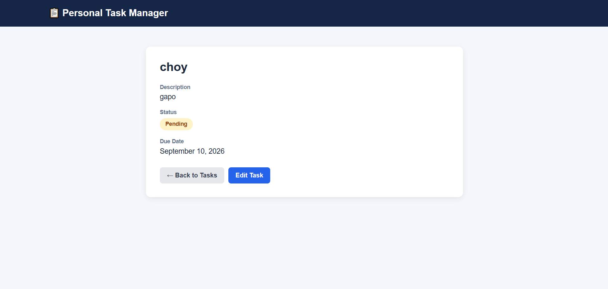
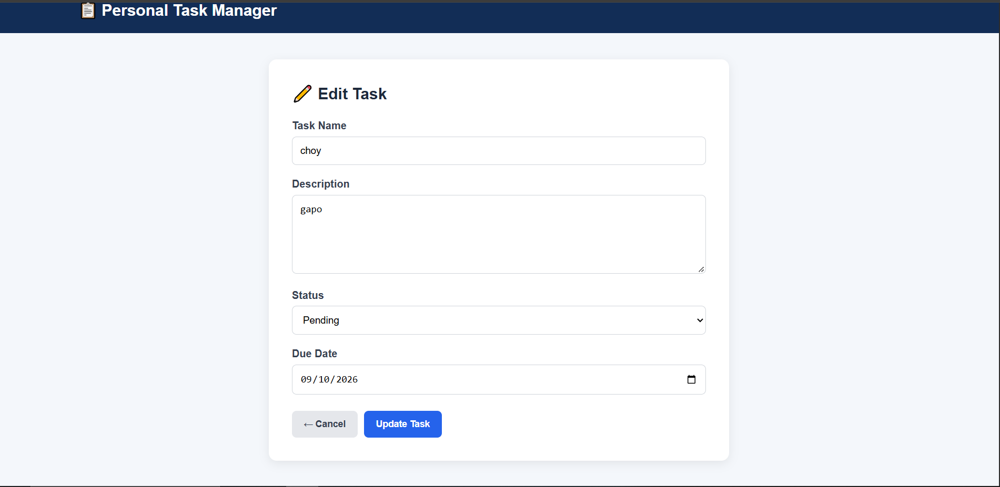
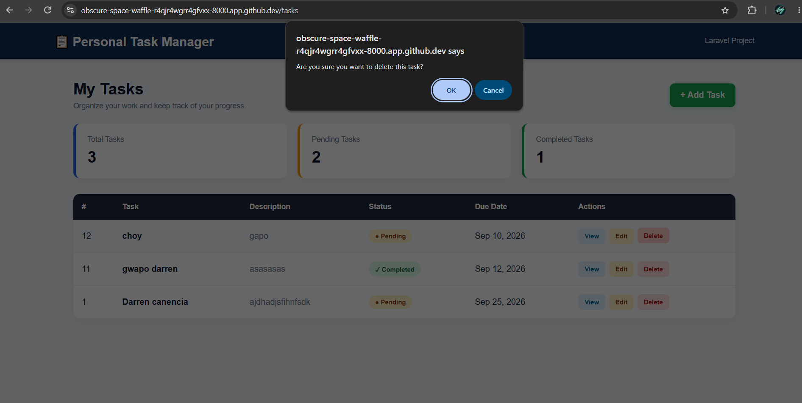

# Personal Task Manager

**Project Code:** WST21-PM-2026-SF  
**Student Name:** Canencia, Darren M  
**Course & Year:** BSIT Second Year  
**Database Used:** SQLite  

## Features

- Add Task
- View Tasks
- Edit Task
- Delete Task
- Update Status

## Additional Features

- Task due dates
- Task descriptions
- Pending and Completed status
- Delete confirmation
- Responsive design
- Success messages after task actions

## How the System Works

1. Open the Personal Task Manager.
2. Click **Add Task** to create a new task.
3. Enter the task name, description, status, and due date.
4. Click **Create Task** to save the task.
5. The saved task appears in the task list.
6. Click **View** to see the task details.
7. Click **Edit** to modify the task.
8. Click **Delete** to remove the task.

## Screenshots

### Task List

### Add Task

### View Task

### Edit Task

### Delete Task
